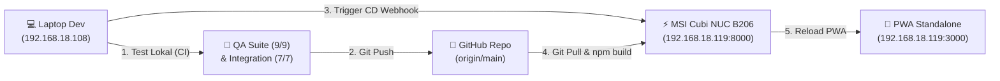

# 🚀 PANDUAN LENGKAP CI/CD PWA KE MSI CUBI NUC AI+ B206
**Proyek:** Agentic Sales Hub — PSAJ 2026 Showcase  
**Target Hardware:** Standalone Mini PC **MSI Cubi NUC AI+ B206**  
**IP Address Appliance:** `192.168.18.119` (Port: `3000` PWA, `8000` Backend API)

---

## 🎯 Gambaran Arsitektur CI/CD

Pipeline CI/CD ini menjamin setiap pembaruan kode (baik logika multi-agen AI, perbaikan prompt, maupun tampilan antarmuka PWA) dapat teruji dan tergelar (*deployed*) secara otomatis ke Mini PC Cubi NUC tanpa downtime layanan lokal.



---

## 🛠️ Pilihan Metode Deployment

### Opsi 1: One-Click Deployment Script (Rekomendasi dari Laptop)
Cukup jalankan satu perintah dari PowerShell di laptop Anda:

```powershell
.\scripts\deploy_cubi_nuc.ps1
```
*(Atau di Linux/macOS/WSL: `./scripts/deploy_cubi_nuc.sh`)*

**Urutan Eksekusi Otomatis:**
1. Menjalankan pengujian regresi: `python backend/qa_test_suite.py` (9/9 checks).
2. Menjalankan pengujian integrasi: `python scripts/test_integration.py` (7/7 checks).
3. Melakukan `git push origin main`.
4. Mengirimkan sinyal webhook ke endpoint `POST http://192.168.18.119:8000/api/v1/system/cicd-deploy`.
5. Cubi NUC menarik commit terbaru dan me-rebuild bundle PWA (`npm run build`).
6. Melakukan verifikasi HTTP 200 pada port 3000 (PWA) dan 8000 (Backend).

---

### Opsi 2: Webhook REST API Langsung (Otomasi / cURL)
Anda dapat memicu deployment langsung menggunakan perintah `curl` atau tools HTTP apa pun (Postman, webhook trigger):

```bash
curl -X POST http://192.168.18.119:8000/api/v1/system/cicd-deploy \
     -H "Content-Type: application/json" \
     -d '{"secret_token": "stelagent-b206", "branch": "main", "build_pwa": true, "pull_git": true}'
```

**Contoh Respons Sukses (JSON):**
```json
{
  "status": "deployed",
  "appliance": "MSI Cubi NUC AI+ B206",
  "ip_appliance": "192.168.18.119",
  "commit_sha": "a20c231",
  "branch": "main",
  "pwa_ready": true,
  "timestamp": "2026-11-15T19:16:00.123456"
}
```

---

### Opsi 3: GitHub Actions (Cloud CI)
Repositori ini telah dilengkapi dengan workflow [ci-cd.yml](file:///.github/workflows/ci-cd.yml).
- Setiap kali ada `git push` ke branch `main`, GitHub Actions akan:
  1. Menjalankan linting dan pengujian integrasi Python.
  2. Meng-install dependencies Node.js.
  3. Memvalidasi kompilasi bundle PWA (`npm run build`).
  4. Memverifikasi integritas `manifest.json` dan Service Worker `sw.js`.

---

### Opsi 4: Eksekusi Langsung di Terminal Cubi NUC (Kios / SSH)
Jika Anda sedang terhubung langsung ke Mini PC Cubi NUC:
```bash
cd /path/to/agentic-ai
git pull origin main
cd frontend && npm run build && cd ..
./hardware_benchmark/restart_appliance.sh
```

---

## 📱 Verifikasi PWA di Mini PC & Perangkat Mobile

Setelah CI/CD selesai, buka peramban di perangkat Anda (Laptop, HP Android, iPad):

| Layanan | URL Jaringan (LAN) |
| :--- | :--- |
| **PWA Virtual 3D Office** | `http://192.168.18.119:3000/office` |
| **PWA Pusat Kontrol & Monitoring** | `http://192.168.18.119:3000/dashboard` |
| **PWA Showroom Motor** | `http://192.168.18.119:3000/` |
| **Backend Swagger API** | `http://192.168.18.119:8000/docs` |

> [!TIP]
> **Install sebagai Aplikasi Mandiri (Standalone App):**  
> Pada browser Google Chrome / Microsoft Edge di HP atau laptop, klik ikon **"Install StelAgent"** atau menu titik tiga -> **"Add to Home screen / Install App"**. Aplikasi akan langsung berjalan mandiri tanpa address bar layaknya aplikasi native!
