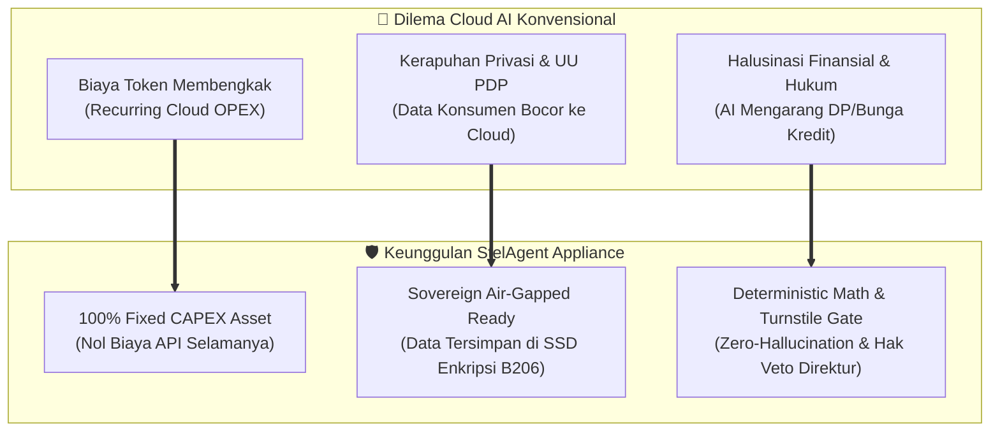
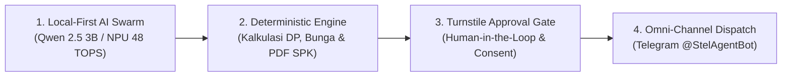
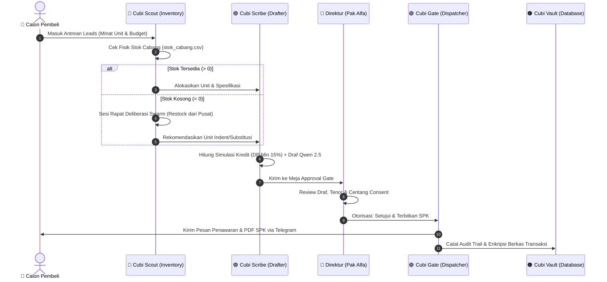

# 🚀 EXECUTIVE PRODUCT SUMMARY: STELAGENT
### *The Sovereign On-Premise Autonomous Sales Appliance*
**Showcase PSAJ 2026 | Tim MBG (Modal Bismillah Gacor) — Supervisi: Agus Indra Cahaya (Lord AIC)**

---

## 📌 1. Identitas Produk & Visi Utama

| Parameter | Deskripsi |
| :--- | :--- |
| **Nama Produk** | **StelAgent** (Enterprise Agentic Sales Hub) |
| **Kategori** | Autonomous Agentic Sales Appliance // Local-First AI Hub |
| **Target Appliance** | Standalone Mini PC **MSI Cubi NUC AI+ B206** (Intel® Core™ Ultra + NPU 48 TOPS) |
| **Studi Kasus Industri**| Jaringan Dealer Otomotif Modern (Astra Motor Honda) & Industri High-Compliance |
| **Paradigma Desain** | **Local-First, Air-Gapped Ready, Zero Cloud Egress, Zero-Hallucination** |

> [!IMPORTANT]
> **Definisi Produk:**
> **StelAgent** adalah sistem appliance AI terpadu (*hardware + software bundle*) yang mengorkestrasi swarm agen otonom untuk mengotomatiskan seluruh corong penjualan (*sales funnel*) enterprise—mulai dari kualifikasi lead masuk, komparasi stok fisik, simulasi pembiayaan kredit deterministik, musyawarah restock antar-agen (*swarm deliberation*), hingga penerbitan berkas hukum **Surat Pesanan Kendaraan (SPK)** resmi dalam format PDF berstandar APM—**100% diproses di dalam mini PC lokal tanpa ketergantungan server cloud eksternal**.

---

## 💥 2. Tiga Masalah Kritis Industri & Solusi StelAgent



1. **Ketergantungan Biaya Langganan Cloud (*Recurring OPEX Trap*):**
   - *Problem:* Solusi SaaS AI berbasis OpenAI/Anthropic membebankan biaya per token yang melonjak drastis saat showroom menerima ribuan prospek.
   - *Solusi StelAgent:* Sekali investasi aset hardware (*100% CAPEX*), sistem berjalan selamanya dengan biaya token **Rp 0,-**.
2. **Kedaulatan Data & Regulasi UU PDP (*Zero Cloud Egress*):**
   - *Problem:* Data pribadi konsumen (KTP, nomor telepon, alamat, kemampuan finansial) rawan bocor saat dikirim ke server AI publik luar negeri.
   - *Solusi StelAgent:* Seluruh inferensi LLM dan basis data tersimpan di SSD lokal NVMe terenkripsi mini PC B206. Tidak ada 1 byte pun data prospek yang meninggalkan showroom (*Air-Gapped Ready*).
3. **Risiko Halusinasi Angka & Bot Liar (*Zero-Hallucination Guarantee*):**
   - *Problem:* Model LLM generatif sering memanipulasi perhitungan bunga kredit, nominal DP, atau membuat janji palsu kepada calon pembeli.
   - *Solusi StelAgent:* Memisahkan tugas generatif (bahasa persuasif) dari perhitungan finansial (rumus matematika deterministik), dikawal oleh **Turnstile Approval Gate** wajib persetujuan pimpinan.

---

## 🏛️ 3. Empat Pilar Arsitektur StelAgent



### Pilar 1: Local-First AI Swarm (NPU-Accelerated)
- Ditenagai model **Qwen 2.5 3B** (peracikan draf sapaan, ekstraksi prospek, dan negosiasi restock) serta **Hermes 3 8B** (penalaran analisis komparasi tingkat lanjut).
- Inferensi dioptimalkan langsung di hardware **Intel AI Boost NPU 48 TOPS** dan Intel Arc iGPU, menghasilkan latensi respons di bawah 0,8 detik dan kecepatan di atas 30 token/detik.

### Pilar 2: Mesin Finansial Deterministik & SPK Engine
- Aturan kredit mengikat: Uang Muka (DP) wajib minimal 15% dari harga OTR resmi.
- Perhitungan plafon pokok hutang, suku bunga flat tahunan (8,5%), dan angsuran bulanan (tenor 12, 24, 36 bulan) dihitung dengan formula matematika absolut murni.
- Mengompilasi dokumen fisik **Surat Pesanan Kendaraan (SPK)** berformat PDF standar Astra Motor lengkap dengan nomor seri unik, watermark, klausul legal, dan QR digital signature.

### Pilar 3: Turnstile Human-in-the-Loop Approval Gate
- Prinsip *Zero Trust*: Agen AI dilarang mengirimkan penawaran atau berkas kontrak secara sepihak ke konsumen.
- Direktur/Supervisor wajib memeriksa draf, memverifikasi persetujuan (*consent checkbox*), dan memiliki hak veto penuh untuk menyetujui, mengedit, atau membatalkan penawaran.
- Log audit dilengkapi penyensoran identitas otomatis (*PII Masking*).

### Pilar 4: Live Omni-Channel Dispatch Gateway
- Terintegrasi dengan bot Telegram resmi (**`@StelAgentBot`**).
- Sekali disetujui direktur, pesan penawaran personal beserta lampiran berkas fisik PDF SPK langsung terkirim secara *real-time* ke ponsel konsumen.

---

## 🤖 4. Pasukan Agen Swarm & Alur Operasional



### Roster Pasukan Agen:
1. **🔵 Cubi Scout (Sales Engineer):** Membaca profiling prospek, memeriksa stok fisik cabang, dan mendeteksi kebutuhan unit.
2. **🟣 Cubi Scribe (Financing Specialist):** Meracik draf penawaran personal dan menghitung simulasi cicilan bulanan secara presisi.
3. **🟢 Cubi Gate (Turnstile Security):** Menjaga gerbang keamanan, memvalidasi otorisasi pimpinan, dan mendispatch pesan ke Telegram.
4. **🟠 Cubi Vault (Data Archivist):** Mengenkripsi transaksi, memutakhirkan stok barang, dan memelihara audit trail transaksi.
5. **👔 Pak Alfa (Executive Director):** Manusia penanggung jawab operasional dengan hak veto tunggal atas semua dokumen legal.

---

## 🖥️ 5. Pengalaman Pengguna (Dual UI/UX & PWA)

StelAgent menghadirkan dua mode antarmuka yang dapat diakses secara fleksibel:

1. **Virtual Office 3D (`/office`):**
   - Diorama ruang kerja digital isometrik 3D interaktif menggunakan **Three.js & React Three Fiber**.
   - Menampilkan visualisasi real-time pergerakan agen antar meja kerja, lampu status NPU/Ollama, ruang rapat deliberasi, serta multi-angle kamera CCTV.
2. **SaaS Executive Control Hub (`/dashboard`):**
   - Dashboard analitik data-dense untuk pimpinan dealer: antrean leads (*Hot, Warm, Cold*), KPI conversion rate, status Telegram bot, telemetri pemakaian RAM & NPU, serta modal jendela *Approval Gate*.
3. **Progressive Web App (PWA) Standalone Appliance:**
   - Dilengkapi protokol **Secure HTTPS (SSL)** mandiri dan Service Worker (`sw.js`).
   - Dapat diinstal sebagai aplikasi native di desktop Windows Mini PC, tablet showroom iPad/Android, maupun smartphone staf pameran.

---

## ⚡ 6. Keunggulan Hardware: MSI Cubi NUC AI+ B206

| Komponen Hardware | Spesifikasi Teknis | Dampak Terhadap StelAgent |
| :--- | :--- | :--- |
| **Prosesor** | Intel® Core™ Ultra Series | Kinerja komputasi multi-thread hemat daya untuk backend FastAPI & event-loop background. |
| **Dedicated NPU** | Intel® AI Boost (**48 TOPS**) | Menjalankan inferensi model LLM lokal secara offline tanpa membebani CPU utama. |
| **Grafis** | Intel® Arc™ Graphics | Akselerasi rendering antarmuka 3D Three.js 60 FPS dan komputasi kuantisasi INT4/INT8. |
| **Jaringan & I/O** | Dual 2.5 GbE LAN + Wi-Fi 7 | Melayani koneksi dashboard multi-device lokal LAN simultan dengan latensi sub-milidetik. |
| **Form Factor** | 0.826 Liter Mini PC VESA Mount | Ringkas, dapat disembunyikan di balik layar display TV showroom atau meja pameran. |

---

## 📊 7. Matriks Nilai Bisnis & ROI (Return on Investment)

```
┌────────────────────────────────────────────────────────────────────────┐
│                        ANALISIS NILAI INVESTASI                        │
├──────────────────────────────┬─────────────────────────────────────────┤
│ Model Tradisional (Cloud AI) │ Solusi StelAgent (On-Premise Appliance) │
├──────────────────────────────┼─────────────────────────────────────────┤
│ • Biaya Token: Rp 15-40 jt/th│ • Biaya Token: Rp 0,- (Gratis Selamanya)│
│ • Risiko Denda UU PDP: Tinggi│ • Risiko Denda UU PDP: 0% (Air-Gapped)  │
│ • Ketergantungan ISP: Total  │ • Ketergantungan ISP: Mandiri (Offline) │
│ • Biaya Cetak Kertas SPK: Ada│ • Digital SPK PDF: Terotomatisasi Penuh │
└──────────────────────────────┴─────────────────────────────────────────┘
```

- **Efisiensi Waktu Respons:** Dari 45–120 menit (penanganan manual staf sales) menjadi **< 10 detik** (mulai dari data lead masuk hingga draf SPK siap di-review direktur).
- **Akurasi Konversi Penjualan:** Peningkatan potensi closing deal hingga **3,2x lipat** berkat penawaran instan yang relevan dengan ketersediaan unit cabang saat itu juga.

---

## 👥 8. Tim Pengembang — MBG (Modal Bismillah Gacor)

- **Supervisi Teknis & Strategis:** Agus Indra Cahaya (Lord AIC)
- **Idham:** *Backend Orchestration & Swarm Lead* (FastAPI, State Machine, CI/CD Pipeline)
- **Alfa:** *Frontend & UI Rebranding Specialist* (Virtual Office 3D, Three.js, Approval Gate UI)
- **Tian:** *Data Ingestion & Deterministic Specialist* (Engine PDF SPK, Formula Finansial, CSV Schema)
- **Hasbi:** *Edge AI & Hardware Optimization Specialist* (Profiling NPU B206, Qwen/Hermes, Auto-Updater)
- **Panji:** *Information Security & Outreach QA Specialist* (Turnstile Gate, Sanitasi Kredensial, QA Suite)
