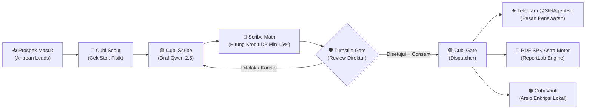

<div align="center">

# 🤖 STELAGENT
### **Local-First Enterprise Autonomous Sales Appliance**
**Showcase PSAJ 2026 // Air-Gapped Multi-Agent Intelligence Hub**

[](https://id.msi.com/)
[](https://www.intel.co.id/)
[](https://ollama.com/)
[](https://fastapi.tiangolo.com/)
[](https://threejs.org/)
[](#-keamanan-kredensial--kebijakan-data)
[](https://t.me/StelAgentBot)

---

### **Supervisi & Bimbingan:** Agus Indra Cahaya (Lord AIC)  
**Organisasi / Tim:** MBG (Modal Bismillah Gacor)  
**Nama Proyek:** Agentic AI // **Nama Produk:** StelAgent  

[📌 Ringkasan](#-ringkasan-eksekutif) • [🏛️ 4 Pilar Utama](#️-4-pilar-utama-arsitektur-stelagent) • [🤖 Pasukan Swarm](#-pasukan-agen-swarm-personil--peran) • [🖥️ Mode Antarmuka](#️-dua-mode-antarmuka-pengguna-uiux) • [⚡ Spesifikasi Hardware](#-arsitektur-hardware-msi-cubi-nuc-ai-b206) • [🚀 Cara Menjalankan](#-panduan-menjalankan-sistem) • [👥 Tim Pengembang](#-tim-pengembang--pembagian-peran)

---

</div>

## 📌 Ringkasan Eksekutif

**StelAgent** adalah sistem orkestrasi multi-agen AI otonom (*autonomous agentic swarm*) tingkat *enterprise* yang dirancang dengan paradigma **Local-First & Air-Gapped Ready**. Seluruh pemrosesan kecerdasan buatan, komputasi finansial deterministik, penyimpanan basis data prospek, dan penerbitan dokumen hukum dijalankan 100% secara lokal di dalam unit mini PC **MSI Cubi NUC AI+ B206** tanpa ketergantungan API cloud pihak ketiga (*zero cloud egress*).

Dalam studi kasus implementasinya, StelAgent bertindak sebagai **kantor operasional digital untuk showroom dealer otomotif modern** (studi kasus: jaringan dealer Astra Motor Honda), mengotomatiskan seluruh siklus penjualan mulai dari kualifikasi prospek masuk hingga penerbitan berkas fisik hukum Surat Pesanan Kendaraan (SPK).

### ⚖️ Perbandingan: Cloud AI Konvensional vs StelAgent Appliance

| Parameter | Solusi Cloud AI Konvensional | **StelAgent On-Premise Appliance** |
|:---|:---|:---|
| **Kedaulatan Data** | Rentan bocor ke server pihak ketiga di luar negeri | **100% On-Premise (SSD Terenkripsi Lokal, UU PDP Ready)** |
| **Biaya Operasional** | Tagihan API membengkak per token (*Recurring OPEX*) | **Nol Biaya API Selamanya (*100% Fixed CAPEX Asset*)** |
| **Keandalan Jaringan** | Lumpuh total jika internet showroom putus | **Air-Gapped Ready (Tetap aktif 100% saat offline)** |
| **Akurasi Finansial** | Rawan halusinasi nominal uang dan tenor kredit | **Zero-Hallucination (Perhitungan matematis deterministik)** |
| **Kontrol & Keamanan** | Bot bertindak otonom tanpa supervisi pimpinan | **Turnstile Human-in-the-Loop (Hak Veto Direktur Wajib)** |
| **Latensi Respon** | 3.0s – 8.0s (tergantung antrean server cloud) | **< 0.8s (Akselerasi dedicated NPU 48 TOPS)** |

---

## 🏛️ 4 Pilar Utama Arsitektur StelAgent

```
┌────────────────────────────────────────────────────────────────────────┐
│                        STELAGENT APPLIANCE HUB                         │
│               (MSI Cubi NUC AI+ B206 — Intel Core Ultra)               │
└──────────────────────────────────┬─────────────────────────────────────┘
                                   │
      ┌────────────────────────────┼────────────────────────────┐
      ▼                            ▼                            ▼
┌──────────────────┐     ┌──────────────────┐     ┌──────────────────┐
│  Local AI Swarm  │     │  Deterministic   │     │ Turnstile Gate   │
│  (Qwen 2.5 3B /  │────▶│  SPK Engine      │────▶│ (Human-in-the-   │
│  NPU 48 TOPS)    │     │  (Zero-Halluc.)  │     │  Loop Approval)  │
└──────────────────┘     └──────────────────┘     └────────┬─────────┘
                                                           │
                                                           ▼
                                                  ┌──────────────────┐
                                                  │ Dispatch Telegram│
                                                  │ (@StelAgentBot)  │
                                                  │ & PDF SPK Resmi  │
                                                  └──────────────────┘
```



1. **Local-First AI Swarm (Kedaulatan Data Penuh & Zero Cloud Egress):**
   - Memanfaatkan model LLM lokal (*Qwen 2.5 3B* dan *Hermes 3 8B*) yang diakselerasi langsung di dedicated hardware NPU 48 TOPS mini PC.
   - Bebas biaya langganan token API cloud bulanan (*Zero Recurring OPEX*) dan tetap beroperasi normal 100% meskipun koneksi internet pameran/kantor offline (*air-gapped ready*).

2. **Kalkulasi Finansial Deterministik & SPK Engine (Zero-Hallucination Guarantee):**
   - Perhitungan uang muka (DP minimal 15%), pokok hutang, plafon kredit, dan simulasi angsuran (tenor 12, 24, 36 bulan) dihitung menggunakan rumus finansial matematis murni (bukan estimasi probabilistik LLM) untuk menjamin akurasi 100%.
   - Menerbitkan berkas fisik resmi **PDF Surat Pesanan Kendaraan (SPK)** ber-kop Astra Motor lengkap dengan nomor registrasi unik, rincian unit, simulasi kredit, dan tanda tangan digital.

3. **Turnstile Human-in-the-Loop Approval Gate:**
   - Menghilangkan risiko AI bertindak liar (*uncontrolled rogue actions*). Direktur atau pimpinan memegang hak veto mutlak melalui jendela otorisasi *Approval Gate* sebelum penawaran didispatch.
   - Dilengkapi validasi *consent_verified*, proteksi anti-spam (jeda acak manusiawi 4–9 detik), serta masking identitas pribadi (*PII Masking*) pada log audit.

4. **Live Outreach Gateway (Telegram Integration):**
   - Setelah disetujui direktur, notifikasi penawaran personal dan berkas fisik PDF SPK resmi dikirimkan secara langsung melalui gateway bot Telegram resmi (**`@StelAgentBot`**) ke calon konsumen atau staf sales.

---

## 🤖 Pasukan Agen Swarm (Personil & Peran)

Di dalam ekosistem StelAgent, tugas operasional dibagi ke dalam swarm agen spesialis yang berkolaborasi secara terkoordinasi:

| Avatar / Agen | Nama Agen | Peran & Spesialisasi | Stasiun Kerja | Tugas & Kontribusi Utama |
|:---|:---|:---|:---|:---|
| 🔵 **Blue Agent** | **Cubi Scout** | *Sales Engineer & Inventory Specialist* | Workstation 01 | Membaca profil prospek, menganalisis ketersediaan stok fisik di cabang showroom, dan merekomendasikan unit motor yang paling tepat. |
| 🟣 **Purple Agent** | **Cubi Scribe** | *AI Pitch & Financing Drafter* | Workstation 02 | Menghitung simulasi kredit, meracik paket promo/bundling aksesoris, dan menyusun draf penawaran personal yang persuasif via model Qwen 2.5 lokal. |
| 🟢 **Green Agent** | **Cubi Gate** | *Turnstile Security & Dispatcher* | Meja Resepsionis | Menjaga gerbang otorisasi pimpinan, memvalidasi kepatuhan *consent*, dan mengeksekusi transmisi pesan serta PDF SPK ke Telegram. |
| 🟠 **Orange Agent** | **Cubi Vault** | *Data Archivist & Compliance* | Server Vault | Menyimpan seluruh riwayat transaksi secara persisten ke database lokal terenkripsi, sinkronisasi stok, dan pencatatan audit log transaksi. |
| 👔 **Director** | **Pak Alfa (Boss)** | *Executive Approver* | Meja Direktur / Rapat | Pimpinan showroom yang memegang kendali otorisasi akhir sebelum SPK diterbitkan dan dikirimkan ke pihak eksternal. |

> 🔄 **Otonom Swarm Deliberation:** Setiap 30 detik agen melakukan *heartbeat check*. Jika stok unit di cabang showroom lokal habis (`0 unit`), agen *Cubi Scout*, *Cubi Supply*, dan *Cubi Gate* berembuk secara otonom di ruang rapat (*Deliberation Room*) untuk menegosiasikan relokasi unit dari Pusat Distribusi tanpa memalsukan data ketersediaan barang kepada konsumen.

---

## 🖥️ Dua Mode Antarmuka Pengguna (UI/UX)

```
Virtual Office 3D (/office)                     SaaS Executive Dashboard (/dashboard)
┌──────────────────────────────────────┐       ┌──────────────────────────────────────┐
│  [🎥 CCTV CAM-01]  [⚡ NPU 48 TOPS]  │       │ METRIK DEAL    ANTREAN PROSPEK       │
│                                      │       │ ┌──────────┐   ┌────────────────────┐ │
│     🔵 Scout ───▶ 🟣 Scribe          │       │ │ 12 Closed│   │ 🟢 Budi Santoso    │ │
│           │            │             │       │ └──────────┘   │ 🟡 Siti Aminah     │ │
│           ▼            ▼             │       │                                      │
│     🟠 Vault ◀─── 🟢 Gate           │       │ [ APPROVAL GATE: REVIEW PENAWARAN ]  │
│                                      │       │ Unit: Beat Street  | DP: Rp 2.895.000│
│  [ MEJA RAPAT: DELIBERASI SWARM ]    │       │ Saluran: Telegram @StelAgentBot      │
│  "Stok Vario 160 habis -> Restock"   │       │ [ Tolak / Batal ] [ Setujui & Kirim ]│
└──────────────────────────────────────┘       └──────────────────────────────────────┘
```

1. **Virtual Office 3D (`/office`):**
   - Representasi spasial isometrik 3D ruang kantor dealer interaktif menggunakan Three.js dan React Three Fiber.
   - Pengguna dapat menyaksikan agen AI berjalan antar stasiun kerja, mengetik draf penawaran, berkumpul di meja rapat saat sesi deliberasi, serta memantau ruangan melalui sudut pandang kamera pengawas CCTV 360°.
2. **SaaS Executive Dashboard (`/dashboard`):**
   - Antarmuka produktivitas data-dense untuk pimpinan dan tim sales: antrean prospek (*Hot, Warm, Cold*), ringkasan KPI konversi deal, grafik telemetri penggunaan token & utilisasi NPU/RAM lokal, log audit aktivitas real-time, dan jendela modal *Approval Gate*.
3. **PWA Ready:**
   - Desain responsif bertaraf Progressive Web App (PWA) yang dapat diinstal langsung di layar desktop, tablet, maupun smartphone staf pameran.

---

## 🌟 Keunggulan Kompetitif & Value Proposition

* **Kedaulatan & Keamanan Data Mutlak (UU PDP Ready):** Seluruh data pelanggan, riwayat penawaran, dan dokumen SPK tersimpan lokal di media penyimpanan SSD terenkripsi hardware B206 (*0 Byte cloud egress*).
* **Nol Biaya Operasional Cloud API (*Zero Recurring OPEX*):** Sekali investasi hardware on-premise (*100% CAPEX Asset*), tanpa tagihan bulanan per-token yang membengkak seiring lonjakan volume leads.
* **Latensi Inferensi Sub-Detik (< 0.8s):** Akselerasi NPU 48 TOPS memberikan respons instan tanpa antrean rate-limit internet publik.
* **Nol Risiko Halusinasi Finansial:** Logika pembiayaan leasing dan dokumen kontrak menggunakan formula deterministik yang terverifikasi hukum.

---

## 👥 Tim Pengembang & Pembagian Peran

Proyek ini dibangun melalui kolaborasi deterministik ke-5 anggota tim di bawah arahan langsung **Agus Indra Cahaya (Lord AIC)**:

| No | Anggota Tim | Peran & Spesialisasi | Kontribusi & Fokus Wilayah |
|:---|:---|:---|:---|
| 1 | **Idham** | *Backend Orchestration & Swarm Lead* | Arsitektur monorepo FastAPI, siklus hidup agen, *background heartbeat*, state machine antrean prospek, dan integrasi API menyeluruh (`backend/main.py`). |
| 2 | **Alfa** | *Frontend & UI Rebranding Specialist* | Antarmuka Virtual Office 3D Three.js/Fiber, rebranding 100% StelAgent, komponen Sales Approval Gate, panel Deliberasi multi-agen real-time, dan unduh PDF SPK (`frontend/`). |
| 3 | **Tian** | *Data Ingestion & Deterministic Document Specialist* | Mesin finansial deterministik nol-halusinasi, penerbitan dokumen PDF SPK ReportLab resmi (`backend/engine_pdf.py`), dan integritas relasional CSV (`backend/workspace/`). |
| 4 | **Hasbi** | *Edge AI & Hardware Optimization Specialist* | Profiling inferensi lokal NPU/iGPU B206 (`hardware_benchmark/`), model runtime `qwen2.5:3b`/`hermes3:8b`, dan daemon auto-updater (`scripts/auto_updater.ps1`). |
| 5 | **Panji** | *Information Security & Outreach QA Specialist* | `SafeOutreachDispatcher` (`backend/dispatcher.py`), sanitasi kredensial (0 hardcoded token/secret), audit logging ter-masking, dan automated test suite (`backend/qa_test_suite.py`). |

---

## ⚡ Arsitektur Hardware: MSI Cubi NUC AI+ B206

Sistem didesain khusus agar dapat berjalan mandiri (*standalone appliance*) pada mini PC **MSI Cubi NUC AI+ B206** dengan spesifikasi:
- **Processor:** Intel® Core™ Ultra Processor dengan arsitektur hybrid performa/efisiensi.
- **NPU Dedicated:** Intel® AI Boost NPU terakselerasi hingga **48 TOPS** untuk inferensi LLM offline.
- **Grafis:** Intel® Arc™ Graphics dengan akselerasi instruksi kuantisasi INT4/INT8.
- **Konektivitas & Keamanan:** Dual 2.5GbE LAN (Port 8000 Backend), isolasi air-gapped total, tanpa transmisi data sensitif konsumen ke server pihak ketiga.

### Profil Model Lokal:
- **`qwen2.5:3b` (Default Fast Pipeline):** Menangani ekstraksi kebutuhan prospek, peracikan draf penawaran Telegram, dan negosiasi pengadaan unit ke pemasok dengan latensi rata-rata $\le 2.3\text{ detik}$ dan kecepatan $\ge 30\text{ tokens/detik}$.
- **`hermes3:8b` (Deep Reasoning):** Menangani evaluasi komparasi multi-cabang kompleks dan audit legal saat dibutuhkan daya penalaran tingkat lanjut.

---

## 🔄 Daemon Auto-Updater Mini PC (`scripts/auto_updater.ps1`)

Untuk mempermudah pemeliharaan unit fisik mini PC di lokasi pameran PSAJ 2026, disediakan skrip pemantau latar belakang otomatis:

```powershell
# Menjalankan pemantau branch main setiap 30 detik di mini PC:
powershell -ExecutionPolicy Bypass -File scripts\auto_updater.ps1 -Branch main -IntervalSeconds 30
```

### Mekanisme Kerja Auto-Updater:
1. **Deteksi Head Commit:** Memeriksa apakah `HEAD != origin/main` setiap 30 detik.
2. **Penanganan Offline Senyap (*Graceful Catch*):** Jika mini PC berada dalam mode *Airplane Mode* / tanpa internet, skrip menangani galat koneksi secara senyap sehingga aplikasi **StelAgent** tetap beroperasi lancar tanpa terganggu.
3. **Pembaruan Otomatis 4-Tahap:**
   - Melakukan `git pull origin main`.
   - Memperbarui dependensi Python (`pip install -r backend/requirements.txt`).
   - Melakukan build aset produksi frontend (`npm run build` di `frontend/`).
   - Me-restart proses layanan lokal backend port 8000 secara halus.

---

## 🛡️ Keamanan Kredensial & Kebijakan Data

1. **Zero Hardcoded Secret:** Repositori diaudit ketat sehingga **0 token Telegram bot, API key, atau kata sandi** yang tertanam di dalam berkas kode maupun Markdown.
2. **Manajemen Environment:** Seluruh konfigurasi privat dikelola via `.env` lokal (tercantum di `.gitignore`) dengan panduan template di `backend/.env.example`.
3. **Pemberian Izin Prospek (*Consent-Driven*):** Tidak ada pesan yang dapat diproses oleh *Approval Gate* tanpa adanya *checkbox consent* aktif dari staf/direktur.
4. **Penyensoran Audit (*PII Masking*):** Seluruh nomor telepon dienkripsi dan di-masking (contoh: `***7801@c.us`) pada berkas `backend/workspace/outreach_audit_log.jsonl`.

---

## 🚀 Panduan Menjalankan Sistem

### 1. Prasyarat Sistem
- Python 3.10+
- Node.js 18+ & npm
- (Opsional) Ollama terpasang dengan model `qwen2.5:3b`

### 2. Menjalankan Backend (FastAPI Core)
```powershell
# Dari direktori root:
python run_backend.py
# Atau via uvicorn langsung:
python -m uvicorn backend.main:app --host 0.0.0.0 --port 8000 --reload
```

### 3. Menjalankan Frontend (StelAgent UI)
```powershell
cd frontend
npm install
npm run dev
# Akses Virtual Office 3D: http://localhost:5173/office
# Akses SaaS Dashboard: http://localhost:5173/dashboard
```

### 4. Menjalankan Pengujian Kualitas (QA Test Suite)
```powershell
# Menjalankan 9 pengujian otomatis (Kesehatan, Lead Queue, Pitch, Gate Consent, Activities, Integritas CSV, Deliberations Swarm, dan Penerbitan Dokumen PDF SPK):
python backend\qa_test_suite.py
```

### 5. Menjalankan Benchmark Hardware B206
```powershell
# Menghasilkan bukti empiris performa NPU/CPU/RAM ke hardware_benchmark/hasil_benchmark_b206.json:
python hardware_benchmark\benchmark_b206.py
```

---

## 📑 Dokumentasi Endpoint Utama Backend

| Method | Endpoint | Deskripsi Fungsi |
|:---|:---|:---|
| `GET` | `/api/v1/system/health` | Telemetri kesehatan appliance, status mode simulasi/live, dan koneksi NPU. |
| `GET` | `/api/v1/leads/queue` | Daftar antrean prospek showroom dengan penilaian prioritas (*Hot*, *Warm*, *Cold*). |
| `POST` | `/api/v1/leads/generate-pitch` | Peracikan draf penawaran personal berbasis analisis unit dan ketersediaan stok fisik cabang. |
| `POST` | `/api/v1/leads/approve-and-send` | Otorisasi direktur dengan validasi *consent*, kalkulasi kredit deterministik, dan penerbitan PDF SPK resmi ke Telegram. |
| `GET` | `/api/v1/documents/{filename}` | Endpoint pengunduhan berkas fisik resmi PDF SPK dari browser. |
| `GET` | `/api/v1/deliberations` | Transkrip koordinasi rapat internal multi-agen (`Scout` -> `Cubi Supply` -> `Gate` -> `Scribe`) saat defisit stok unit 0 terdeteksi. |
| `POST` | `/api/v1/sales/simulasi-kredit` | Simulasi cicilan pembiayaan leasing deterministik (tenor 12, 24, 36 bulan). |
| `POST` | `/api/v1/system/cicd-deploy` | Endpoint webhook penerima sinyal CI/CD deploy otomatis untuk Mini PC Cubi NUC. |

---

<div align="center">

© 2026 **StelAgent // Agentic AI Enterprise Labs**. All Rights Reserved.  
*Showcase PSAJ 2026 — Mini PC MSI Cubi NUC AI+ B206.*

</div>
